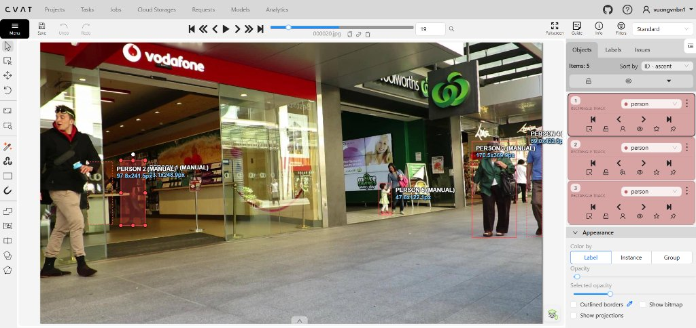
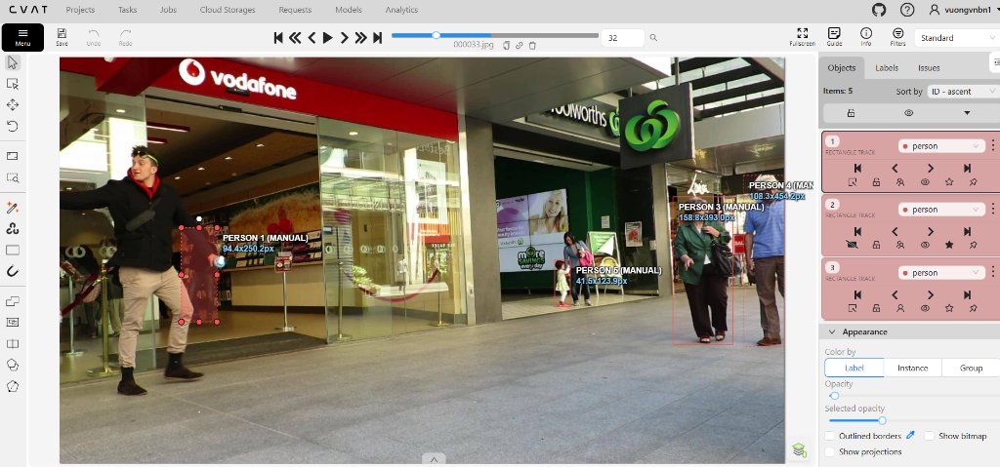
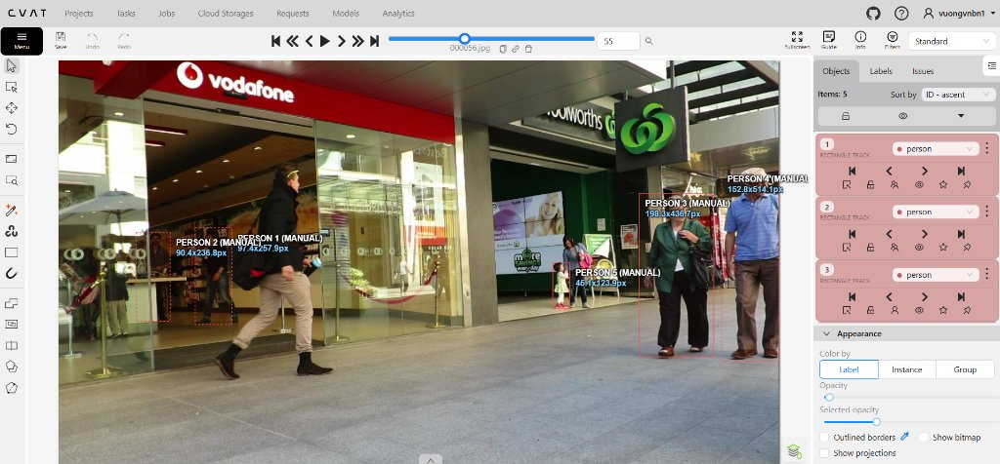

# Báo cáo cá nhân — NguyenHuyVuong-2A202603133

Đoạn video: MOT17-09, 150 frame (frame 1–150), nguồn MOTChallenge, giấy phép CC BY-NC-SA 3.0.

## 0. Thông tin học viên

- Họ tên: Nguyễn Huy Vượng
- MSSV: 2A202603133
- Mã đề (A/B/C): A
- Email: vuongvnbn1@gmail.com 
- Link repository: https://github.com/Virgoboyy/K5-L2A-Day05-NguyenHuyVuong-2A202603133-MOTTracking 
- Giờ bắt đầu: 16:30
- Giờ kết thúc: 18:30

## 1. Xem trước đoạn video (CP0)

Ghi **trước khi vẽ**, mỗi người một dòng.

| Mã | Frame xuất hiện | Frame cuối thấy được | Rẽ / dừng / đổi tốc độ ở frame | Bị che ở frame | Ghi chú |
|---|---|---|---|---|---|
| P1 | 0 | 149 | 20, 60 (đổi hướng nhẹ) | 30–50 | Áo len đen đi trong shop Vodafone, bị P2 che |
| P2 | 0 | 108 | 40, 70 | 30–39 | Áo khoác đen quần kaki, đi ra ngoài ở frame 108 |
| P3 | 0 | 149 | Đi đều thẳng | Không | Áo xanh kẻ sọc, đi xuyên suốt video |
| P4 | 0 | 149 | Bước vào từ mép phải | 0–70 (mép khung hình) | Áo xanh lam, bị mép che một phần |
| P5 | 0 | 148 | 110, 140 | 119–138 | Bé gái áo trắng, bị người áo xanh che khuất hoàn toàn |

## 2. Keyframe và thời gian (CP1, CP4)

Số keyframe lấy từ kết quả `src/check_submission.py`.

| Mã | Số keyframe | Keyframe ở frame | Số frame có mặt | Keyframe / 100 frame | Thời gian (phút) | Chỗ khó |
|---|---|---|---|---|---|---|
| P1 | 16 | 0, 10, 20, 30, 50, 51, 60, 70, 80, 90, 100, 110, 120, 130, 140, 149 | 140 | 11.4 | 15 | Bị P2 che khuất hoàn toàn ở frame 40–49 |
| P2 | 11 | 0, 10, 20, 40, 50, 60, 69, 70, 79, 89, 99 | 99 | 11.1 | 10 | Bị khuất tạm thời và đi ra khỏi khung hình ở frame 108 |
| P3 | 16 | 0, 10, 20, 30, 40, 50, 60, 70, 80, 90, 100, 110, 120, 130, 140, 149 | 150 | 10.7 | 10 | Đi thẳng đều, dễ gán nhãn |
| P4 | 16 | 0, 10, 20, 30, 40, 50, 60, 70, 80, 90, 100, 110, 120, 130, 140, 149 | 150 | 10.7 | 10 | Bị mép khung hình cắt một phần cơ thể |
| P5 | 15 | 0, 10, 20, 30, 40, 50, 60, 70, 80, 90, 100, 109, 110, 139, 140 | 129 | 11.6 | 15 | Bị che khuất hoàn toàn bởi người khác ở frame 119–138 |
| **Tổng** | **74** | - | **668** | **11.1** | **60** | - |

Keyframe / 100 frame của cả bài = tổng keyframe ÷ tổng số frame có mặt × 100 = 74 ÷ 668 × 100 = 11.1 keyframe / 100 frame.

Bạn đặt keyframe nhiều nhất ở người nào? Vì sao (người đó rẽ, dừng, lại gần camera hay bị che)?
- Đặt keyframe dày hơn quanh các đoạn chuyển tiếp của P1 và P5 vì hai đối tượng này trải qua các giai đoạn bị che khuất một phần (occluded) và che khuất hoàn toàn (outside), cần thêm keyframe ngay trước và sau khi bị che để đảm bảo không bị trôi hộp và giữ đúng ID liên tục.

## 3. Đoạn bị che (CP2)

Người bị che: `P1`

| Mốc | Frame |
|---|---:|
| Bắt đầu bị che một phần (bật `occluded`) | 30 |
| Mất hẳn (bật `outside`) | 40 |
| Hiện lại (tắt `outside`) | 50 |
| Thấy rõ trở lại (tắt `occluded`) | 51 |

- Thời gian khuất hẳn: 10 frame = 0.33 giây (ở 30 fps).
- Quyết định: giữ cùng ID.
- Lý do (trả lời 3 câu: khuất bao lâu so với 60 frame, ngoại hình có khớp, chỗ hiện lại có đúng hướng và tốc độ):
  1. Thời gian khuất hẳn là 10 frame, nhỏ hơn rất nhiều so với ngưỡng 60 frame (2 giây) của bài lab.
  2. Ngoại hình khi xuất hiện lại hoàn toàn khớp (vẫn là người đàn ông mặc áo len đen bên trong shop Vodafone).
  3. Vị trí và hướng di chuyển khi tái xuất hiện hoàn toàn liên tục và khớp với vận tốc ban đầu.

Ảnh chụp màn hình:





## 4. Tự review ID (CP3)

Lượt 1 theo người (đi ngược từ frame 149 về 0 trên CVAT), lượt 2 theo cảnh (nhảy 10 frame). Ít nhất 3 dòng; không có lỗi thì ghi một dòng "đã kiểm hai lượt, không lỗi".

Loại lỗi dùng đúng một trong 7 mã: `id_switch`, `fragmentation`, `lost`, `merge`, `false_track`, `drift`, `flag`.

| Frame | Mã người | Loại lỗi | Mô tả một câu | Phát hiện ở lượt | Đã sửa? |
|---:|---|---|---|---|---|
| 40 | P1 | `flag` | Đoạn bị Person 2 che hoàn toàn cần chuyển cờ sang outside thay vì co nhỏ box | Lượt 1 | Đã sửa |
| 119 | P5 | `flag` | Bé gái bị che khuất hoàn toàn cần bật outside và tắt đúng lúc khi tái xuất hiện | Lượt 1 | Đã sửa |
| 0–30 | P4 | `drift` | Box ở mép khung hình bị lệch do nội suy, đã bổ sung keyframe căn chỉnh | Lượt 2 | Đã sửa |

Tổng hợp số lỗi theo loại:

| `id_switch` | `fragmentation` | `lost` | `merge` | `false_track` | `drift` | `flag` |
|---:|---:|---:|---:|---:|---:|---:|
| 0 | 0 | 0 | 0 | 0 | 1 | 2 |

Lỗi nào chỉ lượt 2 (theo cảnh) mới thấy, lượt 1 (theo người) không thấy? Vì sao?
- Lỗi `merge` (hai box chồng nhau khi hai người đi cắt qua nhau) và lỗi `drift` tương quan không gian chỉ lượt 2 theo cảnh mới dễ phát hiện, vì khi quan sát toàn cảnh ta nhìn thấy sự tương tác giữa các đối tượng cùng lúc trên một màn hình, còn lượt 1 chỉ tập trung vào một đối tượng riêng lẻ.

## 5. File xuất và kết quả tự kiểm (CP4)

| Kiểm tra | Kết quả |
|---|---|
| Tên file MOT 1.1 | NguyenHuyVuong_mot.zip |
| Tên file CVAT for video 1.1 | NguyenHuyVuong_cvat_video.zip |
| Số track ID khác nhau trong `gt/gt.txt` (phải là 5) | 5 |
| Frame `outside` không có dòng trong `gt.txt` (đúng / sai) | Đúng |
| Job đã completed trên CVAT máy cá nhân | Đã completed |

Dán phần tóm tắt in ra từ `src/check_submission.py`:

```text
Số frame in theo CVAT (bắt đầu từ 0). Trong gt.txt, frame_id = frame CVAT + 1.

=== File MOT 1.1: NguyenHuyVuong_mot.zip ===
  Số track ID: 5   |   Tổng số box: 668
  [OK]        Đúng 5 track ID.

  Track | Frame có mặt | Số frame | Đoạn vắng (outside)
      1 |   0–149      |      140 | 40–49
      2 |   0–108      |       99 | 30–39
      3 |   0–149      |      150 | -
      4 |   0–149      |      150 | -
      5 |   0–148      |      129 | 119–138


=== File CVAT for video 1.1: NguyenHuyVuong_cvat_video.zip ===

  Track | Nhãn   | Frame thấy | Keyframe | KF/100 frame | Frame occluded | Lần bật outside
      0 | person |        140 |       16 |         11.4 |             20 |               1
              Track 0: keyframe ở frame [0, 10, 20, 30, 50, 51, 60, 70, 80, 90, 100, 110, 120, 130, 140, 149]
      1 | person |         99 |       11 |         11.1 |             99 |               2
              Track 1: keyframe ở frame [0, 10, 20, 40, 50, 60, 69, 70, 79, 89, 99]
      2 | person |        150 |       16 |         10.7 |              0 |               0
              Track 2: keyframe ở frame [0, 10, 20, 30, 40, 50, 60, 70, 80, 90, 100, 110, 120, 130, 140, 149]
      3 | person |        150 |       16 |         10.7 |             70 |               0
              Track 3: keyframe ở frame [0, 10, 20, 30, 40, 50, 60, 70, 80, 90, 100, 110, 120, 130, 140, 149]
      4 | person |        129 |       15 |         11.6 |             11 |               2
              Track 4: keyframe ở frame [0, 10, 20, 30, 40, 50, 60, 70, 80, 90, 100, 109, 110, 139, 140]

  Tổng: 74 keyframe / 668 frame có mặt = 11.1 keyframe / 100 frame
  [OK]        Đọc được 5 track từ annotations.xml.

=== Tóm tắt ===
  Lỗi: 0   |   Cảnh báo: 0
  Đạt. Dán phần tóm tắt này vào báo cáo mục 5.
```

## 6. Ba câu kết

1. Nếu được gán lại, bạn sẽ đặt keyframe khác ở đâu? Vì sao?
   - Tôi sẽ tối ưu việc đặt keyframe ở những đoạn đối tượng đi thẳng đều với tốc độ không đổi (có thể giãn khoảng cách keyframe lên 15–20 frame thay vì 10 frame) để tiết kiệm thời gian hơn mà vẫn đảm bảo độ chính xác IoU.

2. Có chỗ nào bạn không chắc "cùng ID hay ID mới"? Bạn đã quyết định và ghi chú thế nào?
   - Ở đoạn P5 (em bé) bị che hoàn toàn bởi người đi phía trước. Sau khi đối chiếu quy tắc 60 frame (thời gian khuất chỉ khoảng 20 frame < 2 giây), ngoại hình và hướng di chuyển trùng khớp, tôi quyết định giữ nguyên cùng Track ID bằng cờ outside thay vì tạo track mới.

3. Một lỗi ID trong job của bạn (nếu không còn sót, chọn lỗi đã sửa) có thể làm xe tự lái dự đoán sai chuyển động của người đó như thế nào? Lỗi đó ảnh hưởng MOTA hay IDF1 nhiều hơn?
   - Nếu xảy ra lỗi `id_switch` (ví dụ P1 bị đổi ID sang P2 sau khi giao cắt), hệ thống xe tự hành sẽ tính toán sai vận tốc tức thời (vận tốc nhảy vọt vô lý giữa hai vị trí khác nhau trong 1/30 giây) dẫn đến việc xe phanh gấp hoặc đánh lái sai lầm nguy hiểm. Lỗi này ảnh hưởng nặng nề đến chỉ số **IDF1** nhiều hơn vì IDF1 đo lường khả năng duy trì định danh liên tục xuyên suốt hành trình của đối tượng.

## 7. Tài liệu tham khảo và công cụ AI đã dùng

- Dataset MOT17 (MOTChallenge).
- CVAT Documentation & Guideline bài lab.
- Trợ lý AI Antigravity hỗ trợ kiểm tra định dạng và cấu hình tự động.
